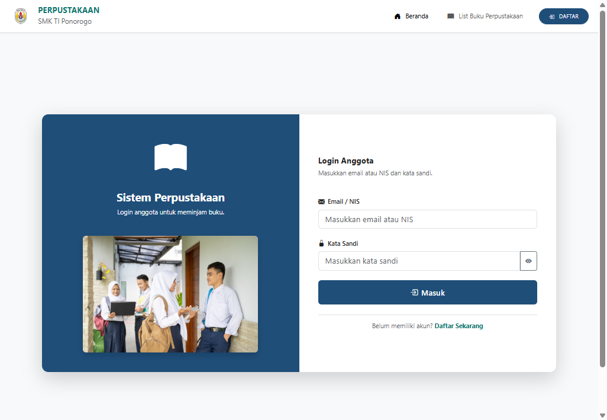
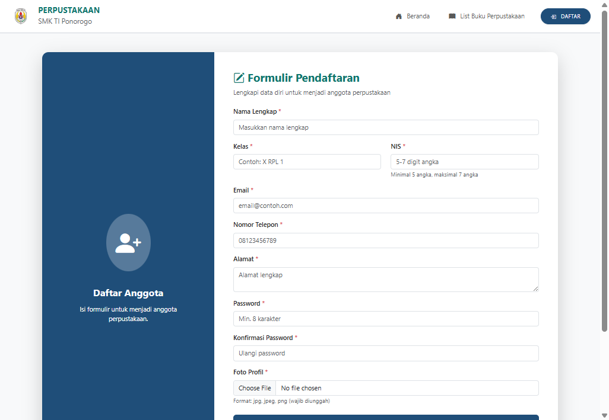
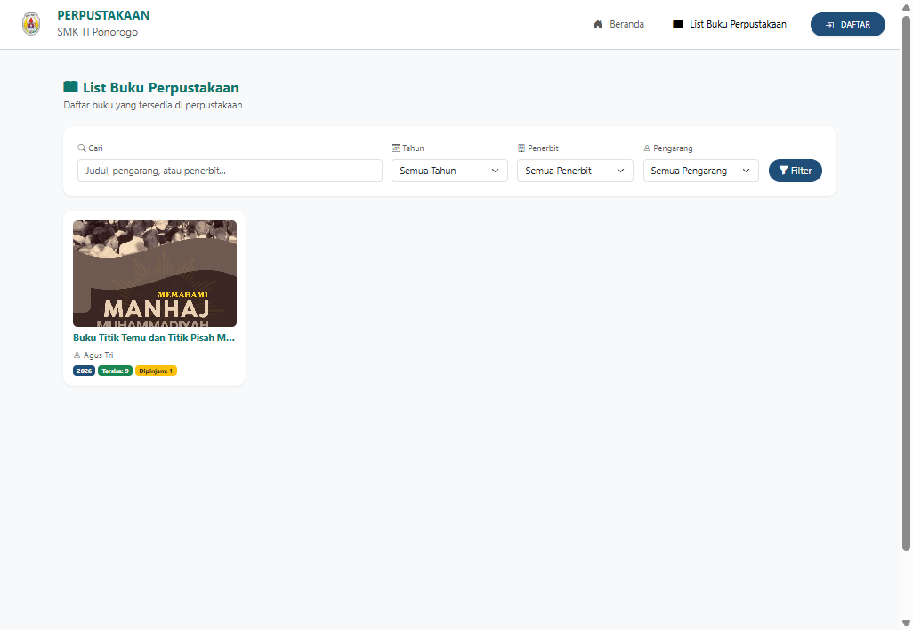
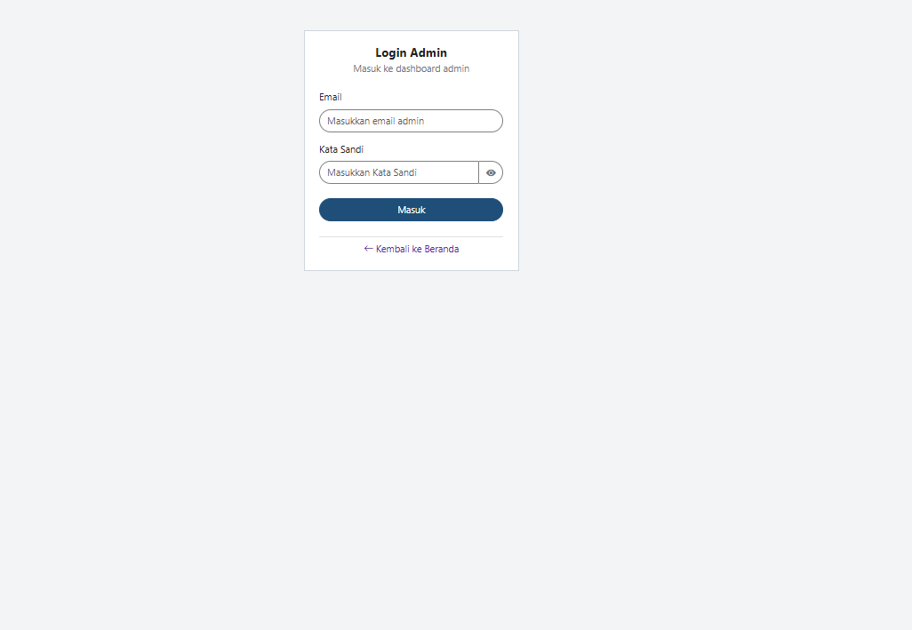

# Perpus Simpel

Sistem perpustakaan sekolah untuk latihan SMK RPL yang bisa dipakai sungguhan. Anggota meminjam buku, admin mengelola stok, denda, antrian, dan laporan.

Dibangun dengan Laravel 12 dan MySQL. Login memakai sesi sendiri (`admin_id` dan `anggota_id`), bukan tabel `users` bawaan Laravel.

## Tampilan

### Beranda anggota



### Daftar anggota



### Katalog buku



### Login admin



## Yang bisa dilakukan

- Anggota mendaftar, menunggu persetujuan admin, lalu login dengan email atau NIS.
- Meminjam buku (batas dan lama pinjam ada di `.env`), memperpanjang, dan mengantri saat stok habis.
- Admin menyetujui anggota, mencatat pengembalian, menghitung denda, mencetak kwitansi dan kartu anggota.
- Kondisi buku: Baik, Rusak, atau Hilang. Buku yang bukan Baik tidak bisa dipinjam.
- Laporan peminjaman, ekspor CSV, dan rekap per kelas.

## Kebutuhan

- PHP 8.2 atau lebih baru, dengan ekstensi `mbstring`, `openssl`, `pdo_mysql`, `tokenizer`, `xml`, `ctype`, `json`, `fileinfo`
- Composer
- MySQL (XAMPP cukup)
- Folder `public/uploads` harus bisa ditulis web server

## Cara menjalankan

1. Salin repositori ini, lalu masuk ke foldernya.

2. Pasang paket PHP:

```bash
composer install
```

3. Siapkan environment:

```bash
copy .env.example .env
php artisan key:generate
```

Di Linux atau macOS gunakan `cp .env.example .env`.

4. Buat database MySQL kosong bernama `perpustakaan`, lalu sesuaikan `.env` bila user atau kata sandi database berbeda:

```env
DB_CONNECTION=mysql
DB_HOST=127.0.0.1
DB_PORT=3306
DB_DATABASE=perpustakaan
DB_USERNAME=root
DB_PASSWORD=
```

5. Buat tabel dan data contoh:

```bash
php artisan migrate
php artisan db:seed
```

6. Jalankan server:

```bash
php artisan serve
```

Buka `http://127.0.0.1:8000`.

Login admin ada di `http://127.0.0.1:8000/admin/index`.

## Akun contoh

Akun ini hanya untuk percobaan. Ganti kata sandinya setelah dipakai di sekolah.

| Peran | Masuk | Kata sandi |
| --- | --- | --- |
| Admin | admin@perpus.local | admin12345 |
| Anggota | siswa@perpus.local atau NIS 12345 | siswa12345 |

Anggota baru yang mendaftar sendiri berstatus menunggu. Admin harus menyetujui dulu di menu List User sebelum anggota itu bisa login.

## Pengaturan

Di `.env`:

```env
PERPUS_MAX_PINJAM=3
PERPUS_LAMA_PINJAM=7
PERPUS_DENDA_PER_HARI=1000
PERPUS_SKIP_RECAPTCHA_LOCAL=true
```

`PERPUS_SKIP_RECAPTCHA_LOCAL=true` melewati Google reCAPTCHA saat `APP_ENV=local`, supaya tetap bisa login di lab yang memblokir Google. Untuk server yang diakses orang lain, isi `RECAPTCHA_SITE_KEY` dan `RECAPTCHA_SECRET_KEY`, lalu set `PERPUS_SKIP_RECAPTCHA_LOCAL=false`.

## Yang tidak ikut di repositori

- File `.env` (kunci aplikasi dan sandi database)
- Folder `vendor` (dipasang lewat `composer install`)
- Foto dan cover yang diunggah pengguna di `public/uploads`

Cover dan foto kosong sampai ada yang mengunggah. Folder unggahan sudah disiapkan.
